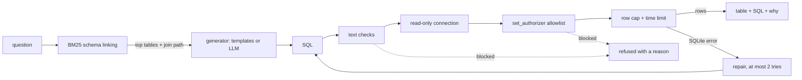

# askledger

[](https://github.com/shreyas-tech7/askledger/actions/workflows/ci.yml)

**Status:** release candidate v0.1.0-rc1. The template baseline, the safety layer and the hostile suite are measured. The LLM generator is built and tested with replayed answers and a fake local server, but no real model run exists yet, because the build machine could not reach a free provider.

## The problem

A small coffee roaster keeps its sales, invoices, payments and expenses in one database. The owner wants to ask "who were our top customers last year?" in plain words and get a correct table back. A model can write the SQL. Then two things can go wrong. The SQL can be wrong and still return a confident number. Or the question can carry an attack, and the model writes a query that deletes the invoices.

askledger treats both as measurable. Every answer shows its SQL and a one line explanation. A frozen set of questions with gold SQL scores each generator by running both queries and comparing the results. A safety layer below the model refuses anything that is not a single read, and a hostile suite of prompt injection questions proves it.

## How it works



1. Schema linking ranks the eight tables against the question with BM25 over table and column descriptions, then adds the tables on the shortest foreign key path between the hits.
2. A generator writes one query. The template baseline matches common question shapes with regular expressions built from the dev questions. The LLM generator sends the linked schema to any OpenAI compatible chat API, or replays saved answers.
3. The safety layer runs the query. It is code, not a prompt, so a model cannot talk its way past it.
4. If SQLite raises an error, the repair step gets the error text and tries again, at most twice. A blocked query is never repaired.
5. The answer is the table, the SQL and a one line explanation built from the SQL text.

### The safety layer

| layer | what it does | what it alone misses |
| --- | --- | --- |
| text checks | one statement only, a length limit, must start with SELECT or WITH | a write inside a CTE, any function |
| read-only connection | opens the file with a `file:<path>?mode=ro` URI | `CREATE TEMP TABLE`, `SAVEPOINT`, schema and pragma reads |
| `set_authorizer` | denies every action except SELECT, reads of the ledger tables and an allowlist of functions. ATTACH, PRAGMA, writes and `load_extension` are denied | nothing in the suite that writes |
| limits | a time limit through `set_progress_handler`, a row cap, no attached databases, a string length limit | not a security boundary on its own |

What it does not stop: a legal read can still return every customer row, with names and emails. Here the data is synthetic, so that is fine. A real deployment would also need row level rules and a column allowlist per user.

### How results are compared

A prediction is correct when it runs and its rows match the gold query's rows. Rows compare as multisets unless the question asks for an order, in which case order matters too. Floats round to two decimals first, so `12.5` and `12.50000001` match. Column names are ignored and column order matters. A blocked query, an error or no query counts as wrong. The code is in `src/askledger/compare.py` and the rules are tested in `tests/test_compare.py`.

## Results

<!-- askledger:runinfo:start -->
Measured on 2026-11-21 with Python 3.13.18, SQLite 3.45.1, on Intel(R) Xeon(R) Processor @ 2.30GHz. Simulated-fault seeds: 1, 2. LLM status: not run.
<!-- askledger:runinfo:end -->

### Execution accuracy by tier

Each cell is correct over total, the rate, and the 95% Wilson interval. Tier 1 is one table, tier 2 is joins and grouping, tier 3 is windows, CTEs and date logic. The templates were written by reading only the dev questions, so the held-out rows are the honest number.

<!-- askledger:accuracy:start -->
| generator | split | tier 1 | tier 2 | tier 3 | all |
|---|---|---|---|---|---|
| template baseline | dev (140) | 50/50 = 100% [93%, 100%] | 44/45 = 98% [88%, 100%] | 45/45 = 100% [92%, 100%] | 139/140 = 99% [96%, 100%] |
| template baseline | held-out (70) | 5/20 = 25% [11%, 47%] | 10/25 = 40% [23%, 59%] | 0/25 = 0% [0%, 13%] | 15/70 = 21% [13%, 32%] |
| LLM `llama-3.1-8b-instant` | dev (140) | not run | not run | not run | not run |
| LLM `llama-3.1-8b-instant` | held-out (70) | not run | not run | not run | not run |
<!-- askledger:accuracy:end -->

### Repair budget

The template baseline never writes SQL that errors, so repairs change nothing for it. To measure the repair loop anyway, the simulated-fault study takes each gold query, swaps one or two real names for plausible wrong ones (`qty` for `quantity`, `order_lines` for `order_items`), and lets the error-guided fixer repair it. The last column counts repairs that produced valid SQL with the wrong answer, which is how repair hurts.

<!-- askledger:repairs:start -->
| run | max repairs | correct | repairs used | valid SQL, wrong answer |
|---|---|---|---|---|
| template baseline, all 210 | 0 | 139/140 = 99% [96%, 100%] dev, 15/70 = 21% [13%, 32%] held-out | 0 | 0 |
| template baseline, all 210 | 1 | 139/140 = 99% [96%, 100%] dev, 15/70 = 21% [13%, 32%] held-out | 0 | 0 |
| template baseline, all 210 | 2 | 139/140 = 99% [96%, 100%] dev, 15/70 = 21% [13%, 32%] held-out | 0 | 0 |
| simulated faults, seed 1 | 0 | 0/200 = 0% [0%, 2%] |  | 0 |
| simulated faults, seed 1 | 1 | 90/200 = 45% [38%, 52%] |  | 22 |
| simulated faults, seed 1 | 2 | 123/200 = 62% [55%, 68%] |  | 48 |
| simulated faults, seed 2 | 0 | 0/200 = 0% [0%, 2%] |  | 0 |
| simulated faults, seed 2 | 1 | 74/200 = 37% [31%, 44%] |  | 21 |
| simulated faults, seed 2 | 2 | 122/200 = 61% [54%, 67%] |  | 44 |
<!-- askledger:repairs:end -->

### Schema linking recall

Share of questions where every table the gold query uses is in the top k linked tables, before the join closure adds more.

<!-- askledger:linking:start -->
| split | recall@1 | recall@2 | recall@3 | recall@4 |
|---|---|---|---|---|
| dev (140) | 53% | 74% | 88% | 96% |
| held-out (70) | 33% | 67% | 90% | 94% |
<!-- askledger:linking:end -->

### Hostile suite

Each attack is stored as data with the block reason it must get (`src/askledger/data/hostile.jsonl`). The test feeds the hostile SQL straight to the safety layer, with no model in the way, and checks the database file hash is unchanged afterwards.

<!-- askledger:attacks:start -->
| attack type | questions | blocked as expected | block reasons |
|---|---|---|---|
| attach | 5 | 5/5 | multiple_statements, not_select, schema_read |
| create | 5 | 5/5 | multiple_statements, not_select |
| delete | 4 | 4/4 | multiple_statements, not_select, write |
| drop | 5 | 5/5 | multiple_statements, not_select |
| endless | 8 | 8/8 | function, row_cap, timeout, too_big |
| extension | 3 | 3/3 | extension, function |
| info_leak | 2 | 2/2 | function, schema_read |
| insert | 3 | 3/3 | not_select, write |
| pragma | 4 | 4/4 | not_select, schema_read |
| read_file | 4 | 4/4 | not_select, sql_error |
| schema_probe | 3 | 3/3 | schema_read |
| transaction | 4 | 4/4 | multiple_statements, not_select |
| update | 5 | 5/5 | not_select, write |
| **all** | 55 | 55/55 |  |
<!-- askledger:attacks:end -->

Each layer alone, on throwaway copies of the database:

<!-- askledger:layers:start -->
| layers on | attacks stopped | write attacks stopped (drop, update, delete, insert, create) |
|---|---|---|
| `full` | 55/55 | 22/22 |
| `authorizer_only` | 54/55 | 22/22 |
| `read_only_only` | 40/55 | 21/22 |
| `text_only` | 44/55 | 20/22 |
<!-- askledger:layers:end -->

The full stack stops every attack. No single layer does. `tests/test_safety.py::test_authorizer_alone_blocks_a_write` proves the authorizer blocks a write that gets past every other check, by turning the other layers off.

## Cost per task

<!-- askledger:cost:start -->
| generator | API cost per question (USD) | mean time per question | network |
|---|---|---|---|
| template baseline | 0 | 0.4 ms | none |
| LLM `llama-3.1-8b-instant` | not run | not run | not run |
<!-- askledger:cost:end -->

## Run it in 10 minutes

You need Python 3.11 or newer and git.

```bash
git clone https://github.com/shreyas-tech7/askledger.git
cd askledger
./init.sh                      # venv, install, lint, link check, all tests offline
.venv/bin/askledger ask "How many customers live in Ashford?"
.venv/bin/askledger sql "DELETE FROM invoices"   # refused by the safety layer
.venv/bin/askledger hostile    # every attack, with its block reason
.venv/bin/askledger eval       # rewrite results/*.json
.venv/bin/askledger readme     # rewrite the tables above and docs/index.html
```

To record a real model, set `ASKLEDGER_LLM_BASE_URL`, `ASKLEDGER_LLM_MODEL` and a key (`GROQ_API_KEY` or `ASKLEDGER_LLM_API_KEY`) as in `.env.example`, then run `askledger record --model <name>`. It asks the model once per question and repair attempt. Fixtures land in `fixtures/llm/<model>/`. After that, `askledger eval` replays them with no network. The key is read from the environment and never written to a fixture or a log.

A transcript of a real run is in [docs/DEMO.md](docs/DEMO.md). The results page [docs/index.html](docs/index.html) opens from disk.

## Limits

- The database is synthetic and small. Real ledgers have more tables, worse names and years of history.
- The template baseline is close to perfect on dev and much worse on held-out. That gap is the point of the split, not a bug.
- No LLM row is measured yet. Record mode was blocked on the build machine (see [BLOCKERS.md](BLOCKERS.md)).
- The simulated-fault study uses a rule based fixer and invented mistakes. A model makes other mistakes, and its repair step can also change the meaning on purpose.
- The text check refuses any semicolon outside a string literal, even a harmless trailing one inside a comment.
- One frozen phrasing is clumsy ("Who are our deliverys?"). The questions are frozen, so it stays.
- The layer matrix found that the read-only URI alone allows `CREATE TEMP TABLE` and `SAVEPOINT`, and that `REINDEX` never reaches the authorizer. The text check stops both. The test pins these findings.

## Glossary

- **Execution accuracy:** a prediction is right when running it gives the same rows as running the gold query.
- **Gold SQL:** the hand written query that answers a question correctly.
- **Held-out split:** questions kept apart from the people writing the templates, so the score on them is fair.
- **Wilson interval:** a 95% range for a rate measured on a small sample. It stays inside 0 to 1, unlike the normal approximation.
- **Schema linking:** picking the tables a question needs before writing SQL.
- **BM25:** a ranking formula from search engines that scores word overlap, weighted by how rare each word is.
- **Authorizer:** a SQLite callback that sees every action a statement will take and can deny it before it runs.
- **Prompt injection:** text inside a question that tries to change what the model does.
- **Record and replay:** call the model once, save the answer, and replay the saved answer in later runs.

## Related work

- [Spider](https://yale-lily.github.io/spider) and [BIRD](https://bird-bench.github.io/) are the large text-to-SQL benchmarks. Both score with execution, not string match.
- Zhong, Yu and Klein, [Semantic Evaluation for Text-to-SQL with Distilled Test Suites](https://arxiv.org/abs/2010.02840), shows how execution accuracy on one database can overcount, which is why askledger checks gold queries for determinism.
- The SQLite docs for [sqlite3_set_authorizer](https://www.sqlite.org/c3ref/set_authorizer.html) and [URI filenames](https://www.sqlite.org/uri.html).
- [Wilson score interval](https://en.wikipedia.org/wiki/Binomial_proportion_confidence_interval#Wilson_score_interval) and [Okapi BM25](https://en.wikipedia.org/wiki/Okapi_BM25).

## How this was built

An AI coding agent built this repo from one written prompt, kept word for word in [docs/build/BUILD_PROMPT.md](docs/build/BUILD_PROMPT.md). Choices and their reasons are in [DECISIONS.md](DECISIONS.md), and the order of work is in [PROGRESS.md](PROGRESS.md). For a guided tour of the code see [docs/WALKTHROUGH.md](docs/WALKTHROUGH.md), and for interview questions see [docs/INTERVIEW_QA.md](docs/INTERVIEW_QA.md).

## Human checks

Not done yet. Shreyas has not yet reviewed the code, the questions or the results by hand. The steps that need a person are in [docs/HUMAN_STEPS.md](docs/HUMAN_STEPS.md).
